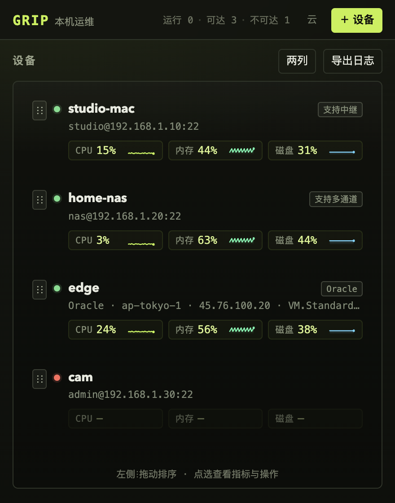
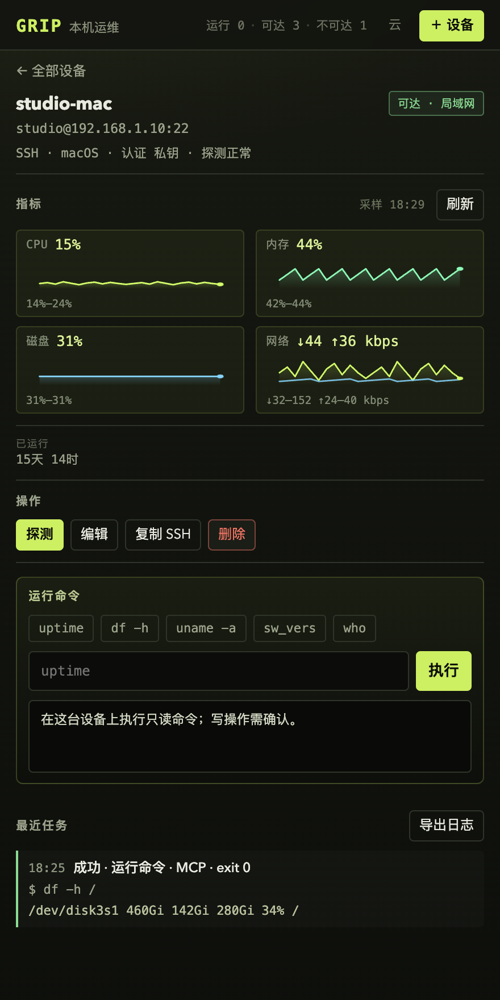
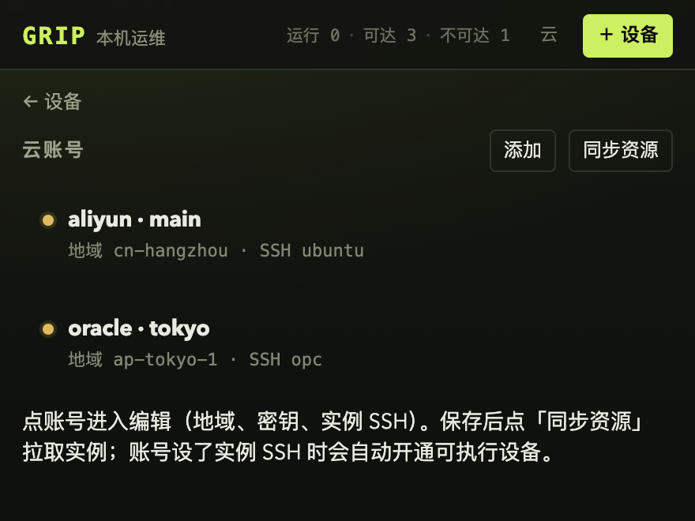

# Grip

Grip 装在你自己的电脑上。菜单栏里看着家里的机器和云上的服务器，本机的 AI 用同一个名字去操作。密码和私钥留在这台电脑的保险库里，不会交给 AI。

人在局域网里，连的是设备自己的内网地址。离开之后，已经接入的设备还是原来的名字：先试汇合点直连，不通再走 TCP 中继。汇合点装在你自己的一台机器上，没有单独的家用网关。

界面默认中文。图标右键可以切到 English。下面三张图是示例数据。

## 面板

左键图标打开面板。绿点是当前这条路通，红点是不通。局域网设备要等汇合点那条路真的连通过，才标「支持中继」「支持直连」或「支持多通道」；人还在局域网里时，仍然先走局域网地址。只登记过、还没连通过的，不标。云上同步来的机器单独标厂商。



点进一台设备，能看 CPU、内存、磁盘和网络，也能下一条命令。最近任务会写明是面板还是本机 AI 下的。列表上的「导出日志」是全部设备，详情里的同名按钮是这一台。



云账号支持阿里云、腾讯云、Oracle、GCP，走 Grip 自己的 HTTPS，不用再装 `oci`、`gcloud`、`aliyun`、`tccli`。账号上填了实例的 SSH 用户和登录私钥后，同步会把有地址的实例变成可执行设备。



右键菜单是：打开面板、固定浮窗、开机启动、切换语言、退出。

## 给本机 AI

把 Grip 配成 MCP。一次调用会说明这次走的是哪条路，以及建议等多久：

| 路 | 返回里的 `path` | 建议等待 |
| --- | --- | --- |
| 局域网 | `lan` | 大约 15 秒，通常几秒就回来 |
| 汇合点直连 | `tunnel` | 大约 30 秒 |
| 汇合点中继 | `relay` | 大约 90 秒，常常要几十秒 |
| 都没有 | `down` | 命令没有发出去 |

按返回里的 `note` 和 `expect_sec` 等。中继上几秒没有回声，不是失败。

安装了菜单栏应用之后，MCP 用应用自己的程序，这样和面板共用同一套数据：

```json
{
  "mcpServers": {
    "grip": {
      "command": "/Applications/Grip.app/Contents/MacOS/Grip",
      "args": ["mcp"]
    }
  }
}
```

AI 能列出设备、下命令、看任务、采样、同步云账号、导出审计。返回里没有 AccessKey、SSH 私钥或密码。

## 安装

安装包在 [Releases](https://github.com/csh995426531/gripapp/releases)：macOS 打开 DMG，Windows 运行安装程序。

从源码跑：

```bash
python3.12 -m venv .venv && source .venv/bin/activate   # Windows: py -3.12 -m venv .venv
pip install -e ".[dev,menubar]"
grip install-menubar --applications --autostart
grip start
```

macOS 打开 `~/Applications/Grip.app`。Windows 双击 `apps\Grip.cmd`。开发机上的启动器仍依赖这份仓库和 `.venv`。

自带 Python 的安装包在 `dist/`，不进 git：

```bash
# macOS，默认未签名
./scripts/build_macos_installer.sh
# 产物: dist/Grip-<version>-macOS.dmg

# Windows 上构建，或推送 v* 标签走 GitHub Actions
# .\scripts\build_windows_installer.ps1
# 产物: dist/Grip-<version>-windows-setup.exe
```

签名和公证见 [`docs/ACCEPTANCE.md`](docs/ACCEPTANCE.md)。

## 离开局域网

汇合点只装一次。人还在局域网时，给要远程管的设备做接入，它会自己往外拨。关掉你这台电脑上的 Grip，不会把对方机器上的接入停掉；下次打开，只是这台电脑重新连上。

```bash
grip tunnel rendezvous --bind 0.0.0.0:443
grip tunnel set-rendezvous https://YOUR_VPS:443
grip tunnel enroll --name studio-mac
```

## 命令行

面板是人的入口。这些命令用来第一次把云账号和 SSH 设备加进去。

```bash
grip cloud-add aliyun --label main \
  --access-key-id "$AK" --access-key-secret "$SK" --region cn-hangzhou

grip cloud-add tencent --label main \
  --secret-id "$SID" --secret-key "$SKEY" --region ap-guangzhou

grip cloud-add gcp --label main --sa-json ./sa.json --project my-proj

grip cloud-add oracle --label main \
  --user-ocid ... --tenancy-ocid ... --fingerprint ... \
  --key-file ./oci_api_key.pem --compartment-id ... --region ap-tokyo-1

grip resource-add-ssh --name home-nas --host 192.168.1.10 \
  --user ubuntu --key-file ~/.ssh/id_ed25519

grip resource-add-ssh --name cam --host 192.168.1.20 \
  --user admin --password-prompt

grip sync-all
grip resource-list
grip mcp
```

## 密钥

密码和私钥进本机保险库。数据库里只存编号，MCP 和导出的日志里是脱敏后的摘要。macOS 上主密钥默认在钥匙串。做不到的是拦住一个已经拥有这台电脑全部权限、并且不听约束的程序。

细节见 [`docs/spec/security/secrets.md`](docs/spec/security/secrets.md)。

## 开发

```bash
pytest -q
```

任务状态、监控分层和接入设计在 [`docs/spec/`](docs/spec/index.md)。

## 社区

本项目认可 [LINUX DO](https://linux.do) 社区，并在那里发布和讨论。
